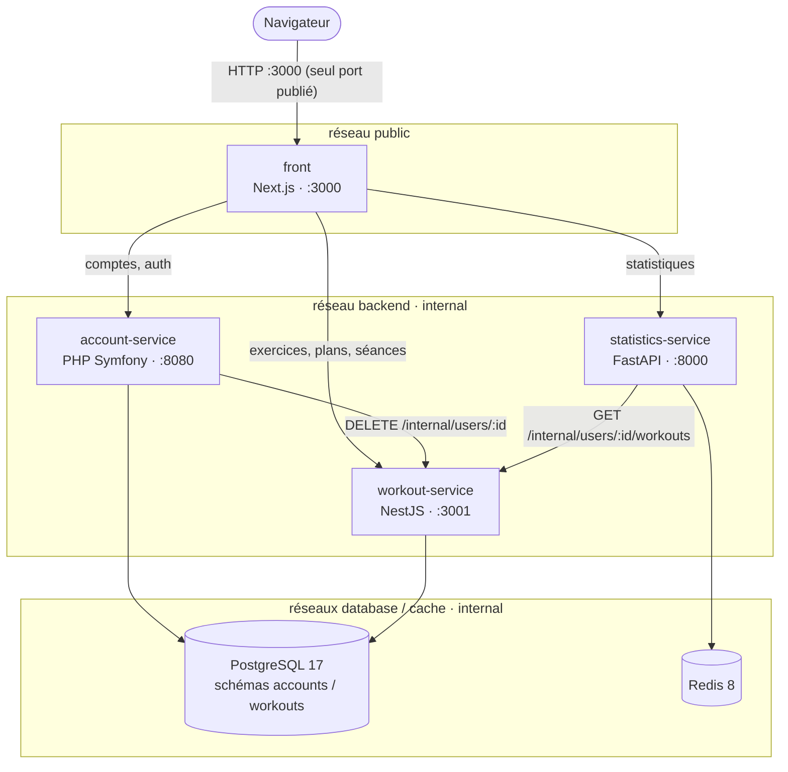
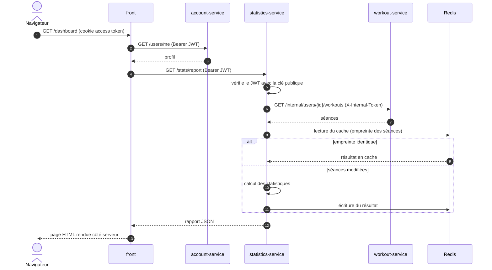
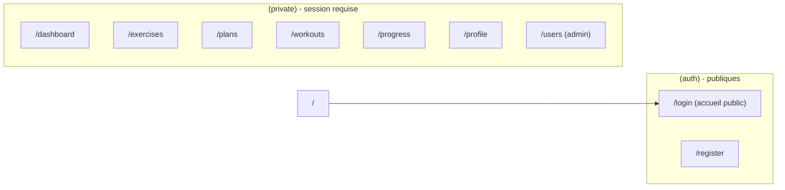

# 1. Architecture logicielle

[← Sommaire](README.md) · [Suivant : Authentification →](02-authentification.md)

## Vue d'ensemble

| Composant | Langage / framework | Rôle |
|---|---|---|
| `front` | TypeScript, Next.js 16 (App Router, Server Components) | Interface web, seul point d'entrée des clients |
| `account-service` | PHP 8.4, Symfony 8.1, Doctrine, LexikJWT, FrankenPHP | Comptes, rôles, authentification JWT, sessions |
| `workout-service` | TypeScript, NestJS, TypeORM | Exercices, groupes musculaires, plans, séances |
| `statistics-service` | Python 3.13, FastAPI, Pydantic | Calculs de progression (volume, records, courbe de force) |
| `postgres` | PostgreSQL 17 | Persistance de l'account-service et du workout-service |
| `redis` | Redis 8 | Cache des statistiques calculées (non persistant) |

L'application compte trois backends écrits dans trois langages (PHP, Node.js,
Python). Chacun expose une API HTTP REST en JSON.

## Principes de découpage

- **Un service = un domaine métier**, avec ses propres données. Aucun service ne
  lit les tables d'un autre ([voir Données](03-donnees.md)).
- **Le front est le seul point d'entrée.** Les appels aux backends sont faits côté
  serveur Next.js (Server Components, Server Actions, route handlers) : le
  navigateur ne parle jamais directement à un backend.
- **Les appels entre services** passent par des routes `/internal/...`,
  protégées par un jeton partagé (`X-Internal-Token`) et jamais appelées par le
  front.
- **L'identité de l'utilisateur vient toujours du JWT**, jamais d'un paramètre
  fourni par le client.

## API des services

### account-service

| Méthode | Route | Description |
|---|---|---|
| POST | `/auth/register` | Création d'un compte « standard » |
| POST | `/auth/login` | Connexion, renvoie un couple access/refresh token |
| POST | `/auth/refresh` | Rotation du refresh token |
| POST | `/auth/logout` | Révocation de la session |
| GET | `/users/me` | Profil de l'utilisateur connecté |
| DELETE | `/users/me` | Suppression de son propre compte |
| GET | `/admin/users` | Liste des comptes (admin) |
| DELETE | `/admin/users/{id}` | Suppression d'un compte standard (admin) |
| GET | `/health` | Healthcheck |

### workout-service

| Ressource | Routes | Description |
|---|---|---|
| Exercices | `GET/POST /exercises`, `GET/PUT/DELETE /exercises/:id` | Catalogue d'exercices de l'utilisateur |
| Groupes musculaires | `GET /muscle-groups` | Référentiel chargé au démarrage |
| Plans | `GET/POST /plans`, `GET/PUT/DELETE /plans/:id`, `POST /plans/:id/exercises`, `DELETE /plans/:id/exercises/:peId` | Modèles de séance |
| Séances | `GET/POST /workouts`, `GET/PUT/DELETE /workouts/:id`, `POST /workouts/:id/exercises`, `DELETE /workouts/:id/exercises/:weId` | Séances réalisées, séries, charges |
| Interne | `DELETE /internal/users/:userId` | Purge des données d'un utilisateur supprimé |
| Interne | `GET /internal/users/:userId/workouts` | Lecture des séances pour les statistiques |

Toutes les routes publiques filtrent les données sur l'utilisateur du JWT.

### statistics-service

| Méthode | Route | Description |
|---|---|---|
| GET | `/stats/overview` | Synthèse du mois courant |
| GET | `/stats/progression` | Évolution du volume |
| GET | `/stats/strength-curve?exerciseId=…` | 1RM estimé par jour (formule d'Epley) |
| GET | `/stats/report?from=…&to=…` | Rapport complet du tableau de bord |
| GET | `/health` | Healthcheck |

Ce service n'a **pas de base de données**. Il lit les séances via l'API interne
du workout-service, calcule les agrégats et les met en cache dans Redis
([voir le cache](03-donnees.md#cache-redis-du-statistics-service)).

## Exemple de parcours : afficher le tableau de bord

## Organisation du code du front

Le front est organisé **par fonctionnalité** (`src/features/<domaine>`) : chaque
domaine (auth, exercises, plans, workouts, statistics, users) regroupe son
client API, ses contrats TypeScript, ses Server Actions et ses composants. Les
pages sont réparties en deux groupes de routes :

## Tests

Chaque service a ses tests unitaires, lancés par la CI à chaque push
([voir CI/CD](06-ci-cd.md)).

| Service | Outil | Contenu |
|---|---|---|
| account-service | PHPUnit 13 | Services (auth, tokens, comptes), voter, client HTTP, entités |
| workout-service | Vitest | Contrôleurs, services, repositories, mappers, policies ; en complément, tests e2e et tests de mutation (Stryker) |
| statistics-service | pytest | Calculs, rapport, authentification, API (workout-service simulé, Redis en mémoire) |
| front | Vitest (+ Playwright pour l'e2e) | Schémas de validation, formatters |
