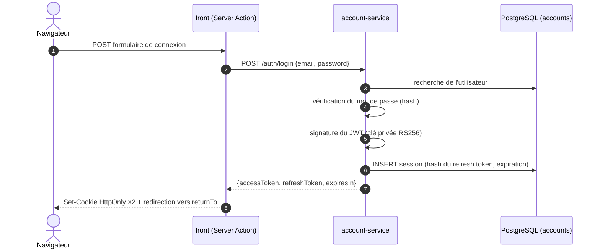
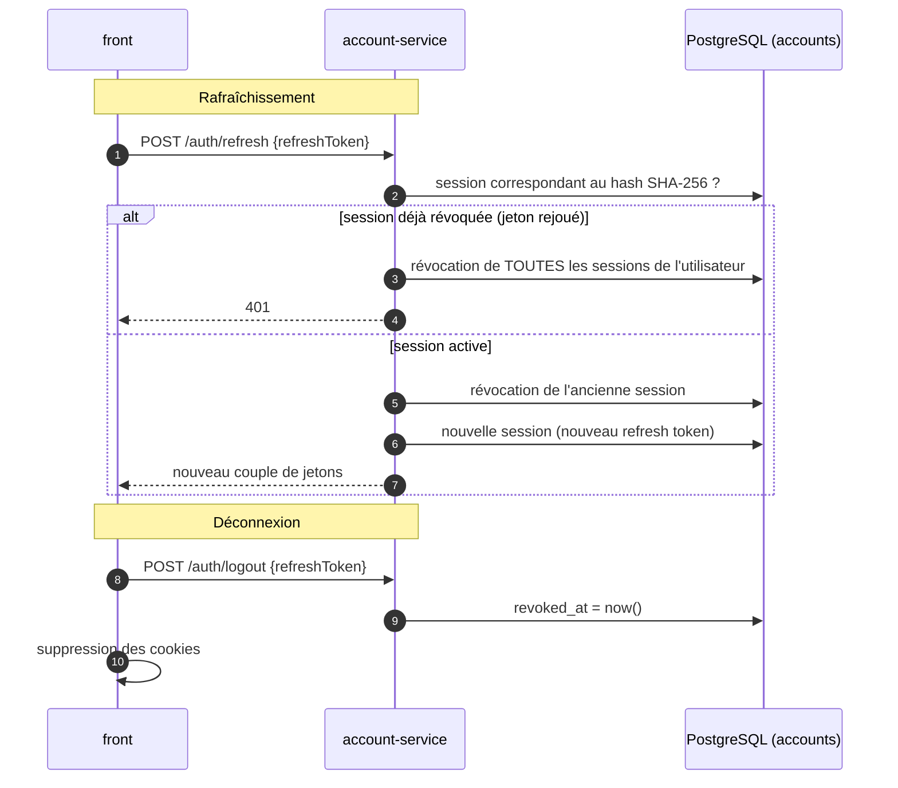
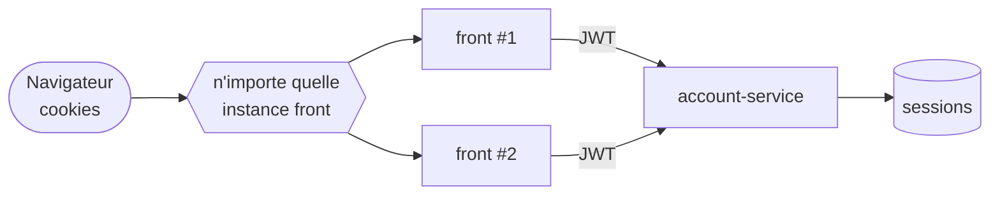
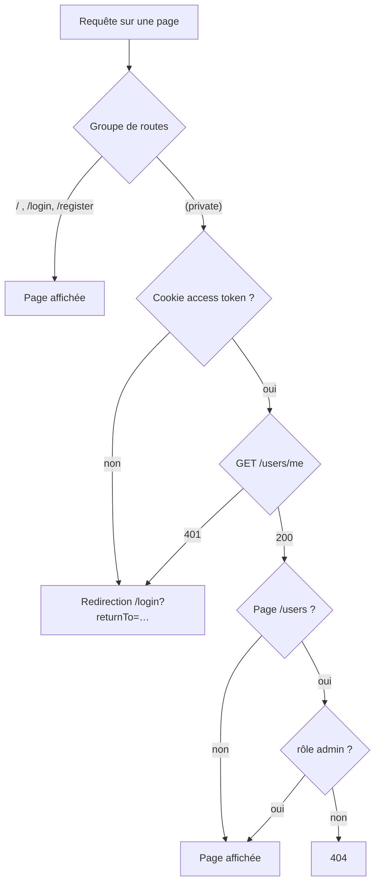
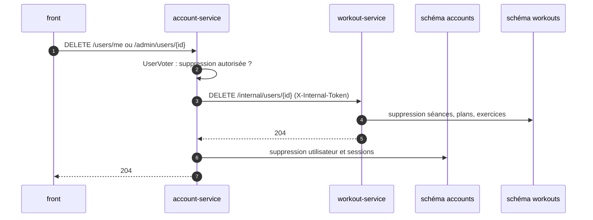

# 2. Authentification et sessions

[← Architecture](01-architecture.md) · [Sommaire](README.md) · [Suivant : Données →](03-donnees.md)

## Principe

- L'**account-service** est le seul service à connaître les mots de passe et le
  seul à signer des jetons. Il signe des **JWT RS256** avec une clé privée qu'il
  est le seul à monter.
- Le **workout-service** et le **statistics-service** vérifient la signature
  avec la **clé publique**. Pour authentifier une requête, ils n'ont pas besoin
  d'appeler l'account-service.
- Le **front** ne stocke rien côté serveur : les jetons sont dans des cookies du
  navigateur.

| Jeton | Durée de vie | Stockage côté client | Stockage côté serveur |
|---|---|---|---|
| Access token (JWT RS256) | 15 min | Cookie `<prefixe>_access_token` | Aucun (vérifié par signature) |
| Refresh token | 7 jours | Cookie `<prefixe>_refresh_token` | **Haché** dans `accounts.sessions` |

Les cookies sont `HttpOnly` (invisibles pour le JavaScript de la page),
`SameSite=Lax`, et `Secure` quand l'application est servie en HTTPS
(`AUTH_COOKIE_SECURE`).

## Connexion



## Rafraîchissement et déconnexion



Chaque refresh token ne sert qu'une fois (rotation). Si un jeton déjà utilisé
est présenté à nouveau, c'est le signe qu'il a été volé : l'account-service
révoque alors toutes les sessions de l'utilisateur, ce qui déconnecte aussi le
voleur.

## Pourquoi le front est sans état



À chaque rendu d'une page privée, le front relit le cookie et appelle
`GET /users/me`. Il n'a ni mémoire de session ni stockage local : n'importe
quelle instance du conteneur `front` peut servir n'importe quelle requête, et un
redémarrage du front ne déconnecte personne. L'état de session est externalisé
dans l'account-service et sa base.

## Contrôle d'accès côté front



- Toutes les pages privées sont sous le layout `(private)`, qui appelle
  `requireCurrentUser()` : un visiteur non connecté est redirigé vers la page de
  connexion, puis renvoyé à la page demandée (`returnTo`) une fois connecté.
- Avant connexion, seules la page d'accueil, `/login` et `/register` sont
  accessibles.
- Le front ne fait que **masquer** ce qui n'est pas autorisé. La vraie
  vérification se fait dans les backends, qui valident le JWT et le rôle à
  chaque requête.

## Rôles et suppression de comptes

| Action | standard | admin |
|---|---|---|
| Créer un compte via le site | Oui (rôle `standard`) | Non (commande console uniquement) |
| Supprimer son propre compte | Oui | Oui |
| Lister les comptes | Non | Oui |
| Supprimer un compte standard | Non | Oui |
| Supprimer un autre admin | Non | Non |

Ces règles sont centralisées dans un *voter* Symfony (`UserVoter`). Un admin se
crée avec :

```bash
docker compose exec account-service php bin/console app:create-admin "Admin" admin admin@nero.local
```

La suppression d'un compte supprime aussi ses données d'entraînement, qui se
trouvent dans un autre service :



Les données d'entraînement sont purgées **avant** le compte : en cas d'échec du
workout-service, le compte est conservé et la suppression peut être relancée.
Aucune donnée ne reste sans propriétaire.
