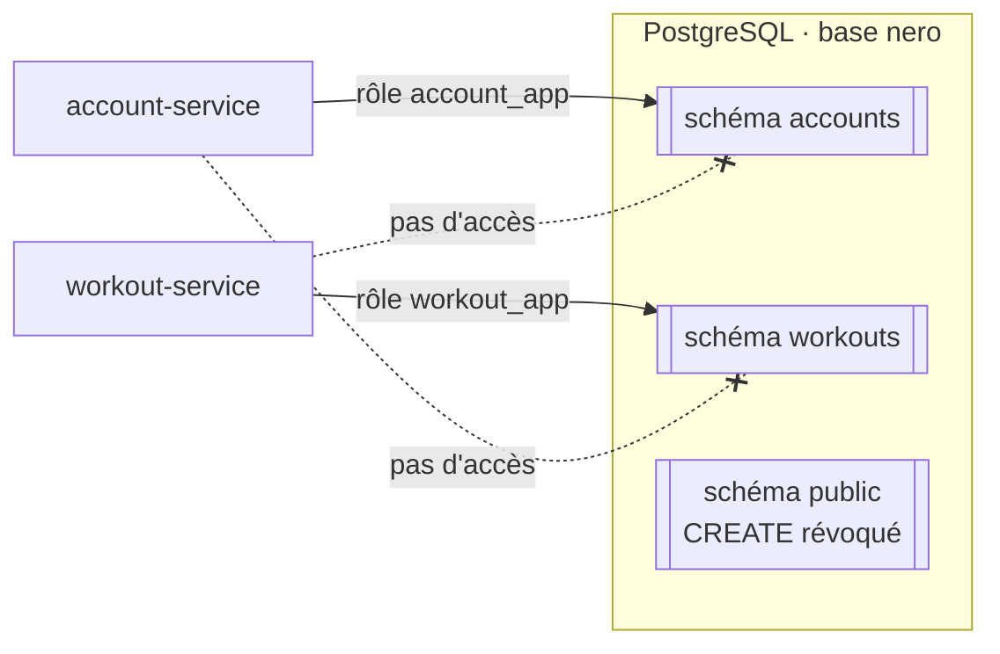
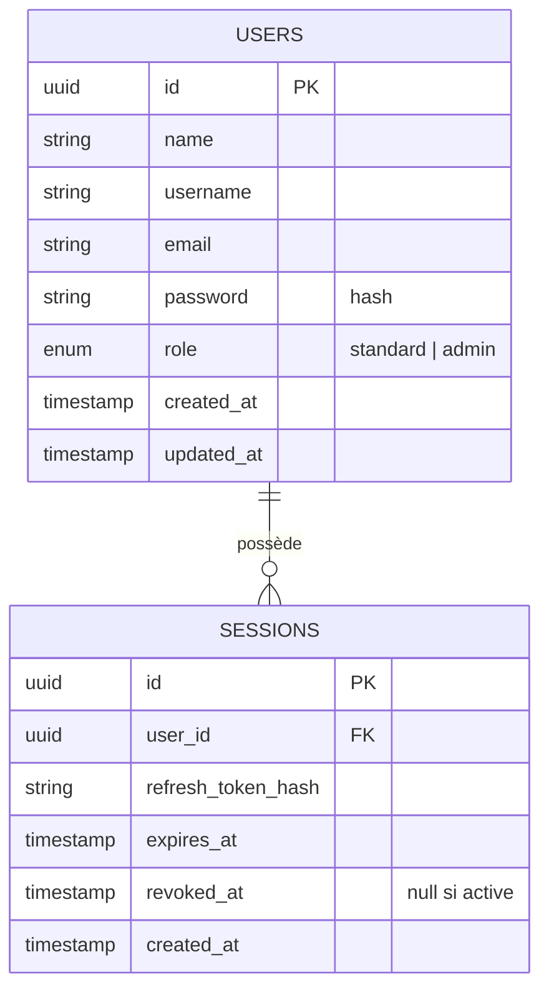
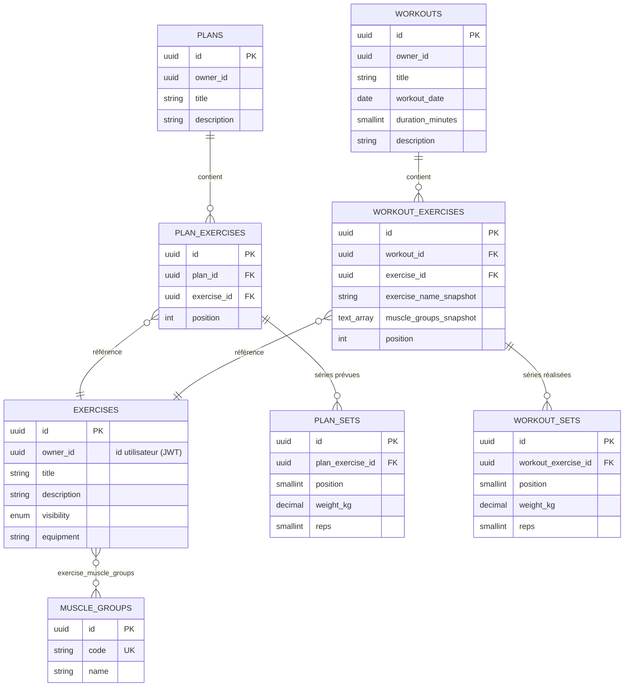
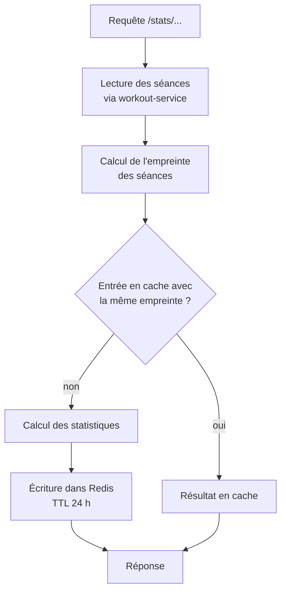

# 3. Données

[← Authentification](02-authentification.md) · [Sommaire](README.md) · [Suivant : Dockerfiles →](04-dockerfiles.md)

## Une base, un schéma et un rôle par service

L'application utilise une seule instance PostgreSQL 17, mais chaque service a
son propre **schéma** et son propre **rôle** :

| Service | Rôle PostgreSQL | Schéma | Migrations |
|---|---|---|---|
| account-service | `account_app` | `accounts` | Doctrine Migrations |
| workout-service | `workout_app` | `workouts` | TypeORM migrations |

Le script `infra/postgres/init.sql`, exécuté au premier démarrage du conteneur :

- crée les rôles sans privilège (`NOSUPERUSER NOCREATEDB NOCREATEROLE`), avec
  les mots de passe lus dans les variables d'environnement ;
- rend chaque rôle propriétaire de son schéma et fixe son `search_path` ;
- retire à tout le monde le droit `CREATE` sur le schéma `public`.

Un service compromis ne peut donc lire que ses propres tables. Les données
partagées passent toujours par une API.

**Pourquoi une seule instance ?** Une instance par service serait plus isolée,
mais consommerait plus de mémoire pour un projet de cette taille. Avec un schéma
et un rôle par service, l'isolation logique est la même. Passer à une instance
par service ne demanderait que de changer `DB_HOST`.

## Modèle de données

### Schéma `accounts`

### Schéma `workouts`

Choix notables :

- **`owner_id` sans clé étrangère vers `accounts.users`.** Une contrainte entre
  schémas couplerait les deux services au niveau SQL. L'identifiant vient du JWT,
  et la cohérence lors d'une suppression de compte est assurée par l'API interne
  ([voir la suppression de compte](02-authentification.md#rôles-et-suppression-de-comptes)).
- **Snapshots dans les séances.** `workout_exercises` conserve le nom de
  l'exercice et ses groupes musculaires au moment de la séance : l'historique et
  les statistiques restent justes même si l'exercice est renommé par la suite.
- **Suppressions en cascade** (`ON DELETE CASCADE`) des plans et séances vers
  leurs exercices et séries.
- Le catalogue des groupes musculaires est (re)chargé par le workout-service à
  chaque démarrage, sans modifier les identifiants existants.

## Cache Redis du statistics-service

Le statistics-service ne stocke aucune donnée durable. Redis ne sert que de
cache pour les calculs :

Les séances sont relues à chaque requête et le cache n'est réutilisé que si leur
empreinte n'a pas changé : un résultat périmé ne peut pas être servi, et aucune
invalidation explicite n'est nécessaire. Le cache évite de refaire des calculs
coûteux, pas des lectures.

Configuration Redis : mot de passe obligatoire, `maxmemory 64mb` avec éviction
LRU, persistance désactivée (`--save ""`, `--appendonly no`). Perdre le cache
ne fait perdre aucune donnée.
