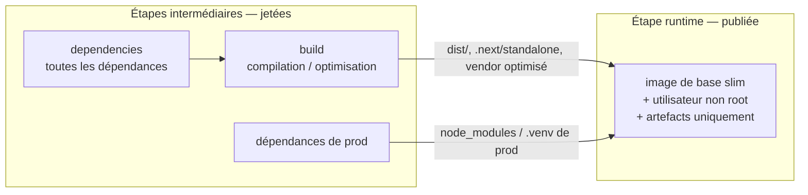
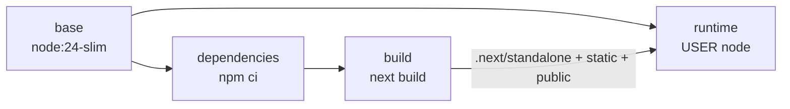
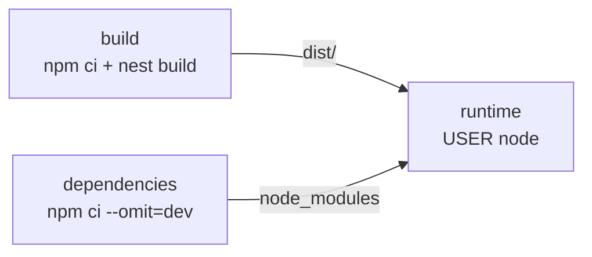
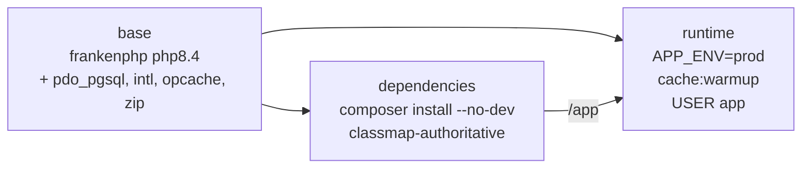
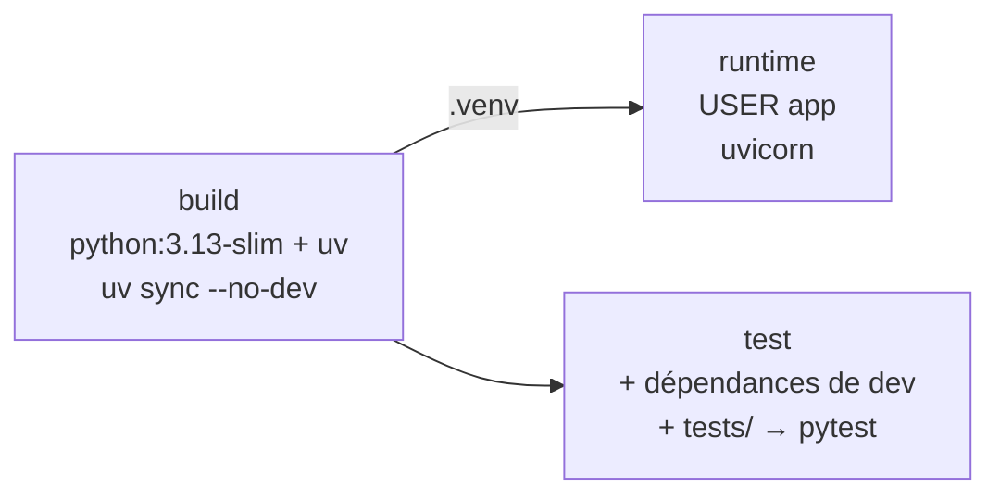

# 4. Dockerfiles

[← Données](03-donnees.md) · [Sommaire](README.md) · [Suivant : docker-compose →](05-docker-compose.md)

Chaque service a son propre `Dockerfile` dans son dossier, ainsi que les deux
images d'infrastructure (`infra/postgres`, `infra/secrets`).

## Principes communs

| Bonne pratique | Mise en œuvre |
|---|---|
| **Builds multi-étapes** | Les outils de build (compilateur TypeScript, Composer, uv, dépendances de dev) restent dans les étapes intermédiaires ; l'étape finale `runtime` ne contient que l'application et ses dépendances de production. |
| **Images de base officielles et épinglées** | `node:24-bookworm-slim`, `python:3.13-slim`, `dunglas/frankenphp:1-php8.4`, `postgres:17`, `alpine:3.22`, en variante *slim* quand elle existe. |
| **Utilisateur non root** | `node` pour les images Node, un utilisateur système `app` sans shell pour PHP et Python. |
| **Ordre des couches** | Les manifestes (`package-lock.json`, `composer.lock`, `uv.lock`) sont copiés et installés avant le code : modifier le code ne réinstalle pas les dépendances. |
| **Cache des gestionnaires de paquets** | `RUN --mount=type=cache` pour npm et uv : le cache sert aux rebuilds mais n'entre pas dans l'image. |
| **Installations reproductibles** | `npm ci`, `composer install` sur le lock, `uv sync --locked`. |
| **Contexte de build minimal** | Un `.dockerignore` par service exclut `node_modules`/`vendor`, `.git`, les fichiers `.env` et les tests. |
| **Pas de secret dans les images** | Secrets et mots de passe sont injectés à l'exécution ([voir compose](05-docker-compose.md#secrets)). |

## Schéma général d'un build multi-étapes

## Détail par image

### front (Next.js)

La sortie Next.js `standalone` produit un `server.js` autonome avec le strict
nécessaire de `node_modules` : l'image finale ne contient ni les sources ni les
dépendances de développement. La télémétrie Next est désactivée.

### workout-service (NestJS)

Le service est installé deux fois, en parallèle : une installation complète pour
compiler, et une installation `--omit=dev` copiée dans l'image finale avec
`dist/`.

### account-service (Symfony + FrankenPHP)

- FrankenPHP réunit le serveur web (Caddy) et PHP dans un seul binaire : pas
  besoin d'un couple nginx + php-fpm.
- L'autoloader Composer est optimisé (`--classmap-authoritative`) et le cache
  Symfony est préchauffé pendant le build, d'où un démarrage rapide.
- Le service écoute sur le port 8080 (non privilégié) et la capability réseau
  du binaire est retirée (`setcap -r`) pour qu'il tourne sous l'utilisateur
  `app`.
- La commande Composer est copiée depuis l'image officielle `composer:2` et
  n'est pas présente dans l'image finale.

### statistics-service (FastAPI)

- uv est copié depuis son image officielle, en version épinglée.
- Le bytecode est précompilé (`UV_COMPILE_BYTECODE=1`).
- L'étape `test` permet de lancer les tests dans un conteneur
  (`docker build --target test`) sans les embarquer dans l'image de production.

### Images d'infrastructure

| Image | Contenu |
|---|---|
| `infra/postgres` | `postgres:17` + `init.sql` dans `docker-entrypoint-initdb.d` (rôles et schémas, [voir Données](03-donnees.md)) |
| `infra/secrets` | `alpine:3.22` + OpenSSL + script de génération des secrets ([voir compose](05-docker-compose.md#secrets)) |

## Healthchecks sans outil supplémentaire

Les healthchecks (déclarés dans le compose) utilisent le langage déjà présent
dans chaque image plutôt que d'y ajouter `curl` :

| Service | Commande |
|---|---|
| account-service | `php -r 'file_get_contents("http://127.0.0.1:8080/health")'` |
| workout-service | `node -e "fetch('http://127.0.0.1:3001/')"` |
| statistics-service | `python -c "urllib.request.urlopen('http://127.0.0.1:8000/health')"` |
| front | `node -e "fetch('http://127.0.0.1:3000/login')"` |
| postgres | `pg_isready` |
| redis | `redis-cli ping` |
