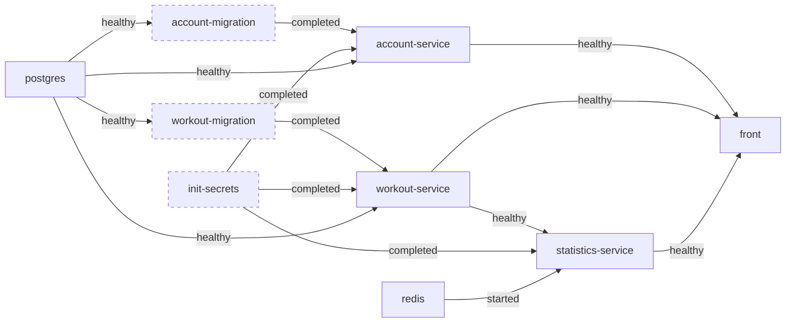
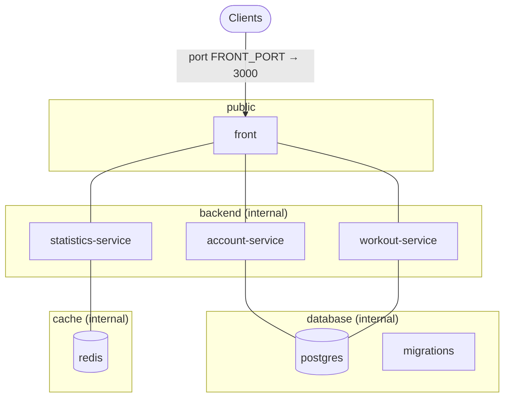
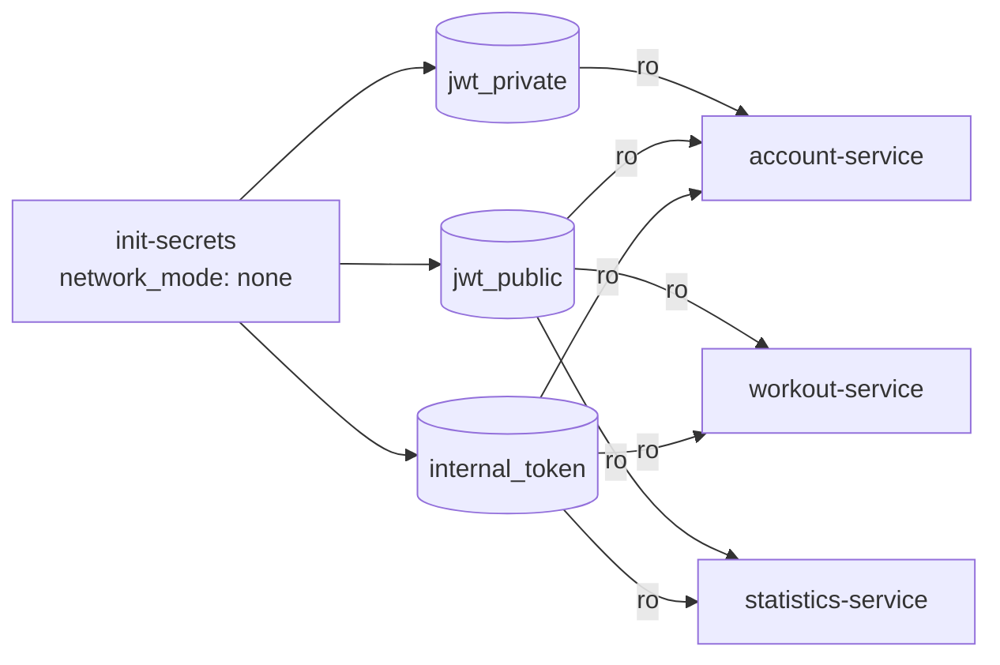
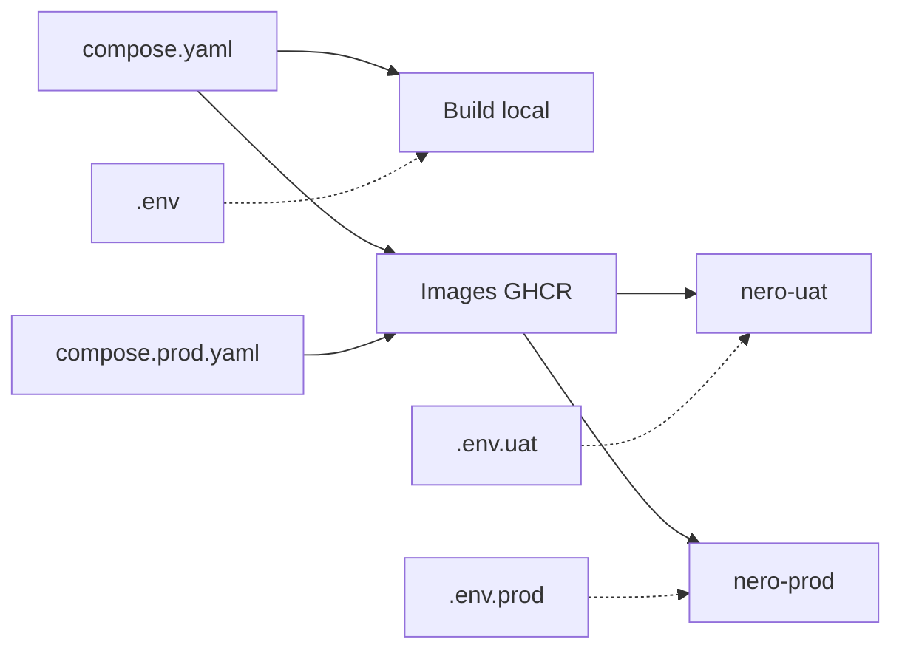

# 5. docker-compose

[← Dockerfiles](04-dockerfiles.md) · [Sommaire](README.md) · [Suivant : CI/CD →](06-ci-cd.md)

## Démarrage local et images publiées

Après copie de `.env.example`, le fichier principal construit les images depuis
les sources et démarre l'application :

```bash
cp .env.example .env
docker compose up -d --build --wait
```

Les valeurs de `.env.example` suffisent pour le démarrage local. Remplacer les
secrets de développement avant un déploiement serveur.

Pour utiliser les images publiées sans construire les sources :

```bash
docker compose -f compose.yaml -f compose.prod.yaml up -d --wait
```

`compose.prod.yaml` est une surcharge : il s'utilise avec `compose.yaml`, dans
cet ordre, et ne constitue pas un stack autonome. Il supprime les sections
`build` avec `!reset`, définit les images GHCR et force leur téléchargement
(`pull_policy: always`). Une version récente de Docker Compose prenant en charge
`!reset` est nécessaire.

`NERO_TAG` vaut `latest` par défaut ; un tag de release ou `sha-<SHA complet>`
sélectionne une version déjà publiée pour les six images. Les migrations
réutilisent les images Account et Workout. Les sources et Dockerfiles ne sont
pas nécessaires dans ce mode : les deux fichiers Compose et le `.env` suffisent.
Si les images sont privées, se connecter au registre avec `docker login ghcr.io`.

Les ports, réseaux, volumes et dépendances restent ceux du fichier principal.
L'application écoute sur `FRONT_PORT` (3000 par défaut) ; cette surcharge ne
configure ni Traefik ni HTTPS.

- `--build`, utilisé en local, construit les images à partir des contextes
  déclarés dans `compose.yaml`. Les quatre images applicatives ciblent l'étape
  `runtime` ; les deux images d'infrastructure utilisent l'étape finale.
- `--wait` attend que les services permanents soient démarrés ou *healthy*,
  selon leur healthcheck. Les tâches ponctuelles doivent terminer avec succès
  avant leurs services dépendants.

## Conteneurs

Les images GHCR ci-dessous ont pour préfixe
`ghcr.io/antonharzhanau/nero-workout-` et pour tag `${NERO_TAG:-latest}`.

| Service | Type | Contexte local | Suffixe GHCR / image externe |
|---|---|---|---|
| `postgres` | permanent | `infra/postgres` | `postgres` |
| `redis` | permanent | — | `redis:8.10.3-alpine3.23` (digest épinglé) |
| `init-secrets` | ponctuel | `infra/secrets` | `init-secrets` |
| `account-migration` | ponctuel | `services/account-service` | `account` |
| `workout-migration` | ponctuel | `services/workout-service` | `workout` |
| `account-service` | permanent | `services/account-service` | `account` |
| `workout-service` | permanent | `services/workout-service` | `workout` |
| `statistics-service` | permanent | `services/statistics-service` | `statistics` |
| `front` | permanent | `front` | `front` |

Redis utilise une image externe dans les deux modes ; il n'est pas construit
localement ni publié par la CI du projet.

Les conteneurs ponctuels (`restart: "no"`) s'arrêtent une fois leur tâche
terminée. Les autres sont en `restart: unless-stopped`.

## Ordre de démarrage

L'ordre ne repose pas sur un simple ordre de lancement : chaque dépendance
attend que l'autre soit **prête** (`service_healthy`) ou **terminée avec
succès** (`service_completed_successfully`).



*(en pointillés : conteneurs ponctuels)*

- Un service ne démarre que si ses **migrations ont réussi** : il ne tourne
  jamais sur un schéma pas à jour.
- Les migrations utilisent **la même image** que leur service, avec une autre
  commande : il n'y a pas d'image à maintenir en plus.
- Dans `compose.yaml`, `account-migration` crée aussi l'administrateur. Il attend
  `init-secrets` et reçoit le jeton interne en lecture seule ainsi que l'URL du
  workout-service, nécessaires à l'initialisation du service de comptes.
- Si une étape échoue, `docker compose up --wait` échoue lui aussi au lieu de
  démarrer une application à moitié fonctionnelle.

## Réseaux



| Réseau | `internal` | Membres |
|---|---|---|
| `public` | non | front |
| `backend` | oui | front, account, workout, statistics |
| `database` | oui | postgres, account, workout, migrations |
| `cache` | oui | statistics, redis |

- **Seul le front publie un port.** Les backends, PostgreSQL et Redis ne sont
  joignables par aucun client.
- Les réseaux `internal: true` n'ont aucun accès vers l'extérieur, ni depuis
  l'extérieur.
- **Moindre privilège réseau** : le front n'est pas sur le réseau `database`,
  le statistics-service non plus, et seul le statistics-service voit Redis. Un
  service compromis ne voit que ce dont il a besoin.

## Secrets

Les secrets de déploiement ne sont pas intégrés aux images. `.env.example`
contient des valeurs publiques de développement pour permettre un démarrage
local immédiat ; elles doivent être remplacées sur le serveur. Les clés JWT et
le jeton interne sont générés dans des volumes au premier lancement.



- **Génération automatique** : au premier lancement, `init-secrets` (sans
  réseau) génère la paire de clés RSA 2048 des JWT et le jeton interne dans des
  volumes nommés.
- **Idempotent** : il ne régénère rien si les secrets existent déjà, et vérifie
  que la clé publique correspond bien à la clé privée. Un redémarrage n'invalide
  donc pas les sessions.
- **Moindre privilège** : seul l'account-service monte la clé privée. Les autres
  ne reçoivent que la clé publique et le jeton interne, toujours en lecture
  seule (`:ro`).
- **Variables obligatoires** : les mots de passe sont déclarés en
  `${VAR:?VAR is required}`. `docker compose` refuse de démarrer si l'une
  d'elles manque, plutôt que de lancer une base sans mot de passe.
- Le fichier `.env` est ignoré par Git ; `.env.example` sert de modèle et fournit
  les mots de passe locaux ainsi que `ACCOUNT_APP_SECRET` et `REDIS_PASSWORD`.

## Factorisation

La configuration de connexion à la base est définie une seule fois avec des
ancres YAML, puis réutilisée par chaque service et sa migration :

```yaml
x-account-db: &account-db
  DB_HOST: postgres
  DB_USER: ${ACCOUNT_DB_USER:?ACCOUNT_DB_USER is required}
  # ...

services:
  account-service:
    environment:
      <<: *account-db
```

Dans `compose.prod.yaml`, l'ancre `x-published` évite de répéter les deux
réglages communs aux images du projet :

```yaml
x-published: &published
  build: !reset null
  pull_policy: always

services:
  front:
    <<: *published
    image: ghcr.io/antonharzhanau/nero-workout-front:${NERO_TAG:-latest}
```

`x-published` est un bloc d'extension, pas un conteneur. `&published` nomme
l'ancre et `<<: *published` insère son contenu dans chaque service. `!reset null`
retire le `build` hérité ; `always` impose le téléchargement de l'image.

## Environnements (TEST / UAT / PROD)

Le fichier `.env` définit les paramètres de chaque environnement. Le mode de
lancement dépend des fichiers Compose sélectionnés : `compose.yaml` pour le
build local ; `compose.yaml` avec `compose.prod.yaml` pour les images publiées.
Le nom `prod` indique ce second mode, qui peut aussi servir à un environnement
de test ou de recette.

| Variable | Rôle | Exemple TEST / UAT / PROD |
|---|---|---|
| `COMPOSE_PROJECT_NAME` | Isole conteneurs, réseaux et volumes sur un même hôte | `nero-test` / `nero-uat` / `nero-prod` |
| `NERO_TAG` | Version des images avec `compose.prod.yaml` ; sans effet sur le build local | `latest` / `sha-<SHA complet>` / `vX.Y.Z` |
| `FRONT_PORT` | Évite les conflits de port | `3000` / `3100` / `80` |
| `AUTH_COOKIE_PREFIX` | Cookies distincts par environnement | `test` / `uat` / `nero` |
| `AUTH_COOKIE_SECURE` | `Secure` obligatoire derrière HTTPS | `false` / `true` / `true` |
| Mots de passe, `ACCOUNT_APP_SECRET`, `REDIS_PASSWORD` | Secrets propres à chaque environnement | — |



Après préparation d'un fichier `.env.uat` avec ses secrets et `NERO_TAG`, par
exemple :

```bash
docker compose --env-file .env.uat -f compose.yaml -f compose.prod.yaml up -d --wait
```

Les fichiers `.env.uat` et `.env.prod` sont à préparer à partir de `.env.example`.
Les deux fichiers Compose ne définissent actuellement pas de limites CPU ou
mémoire ; la surcharge de production ne change que la provenance des images.

## Données de démonstration

`compose.demo.yaml` ajoute un service `demo-fixture` qui n'est chargé qu'à la
demande :

```bash
docker compose -f compose.yaml -f compose.demo.yaml run --build --rm demo-fixture
```

Il crée un compte de démonstration et environ 70 séances sur 24 semaines **en
passant par les API** des services, sans écrire directement dans leurs tables.
Le conteneur est en lecture seule (`read_only: true`) et n'est que sur le réseau
`backend`. Il est idempotent : une relance réutilise les ressources existantes.
