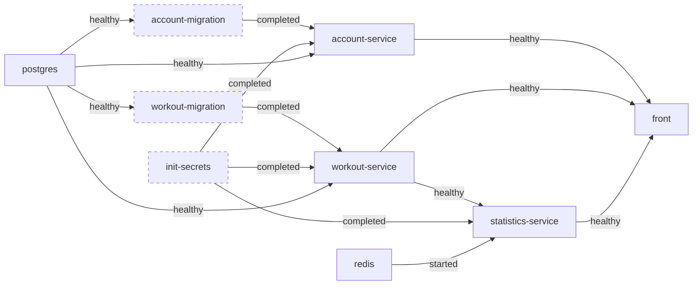
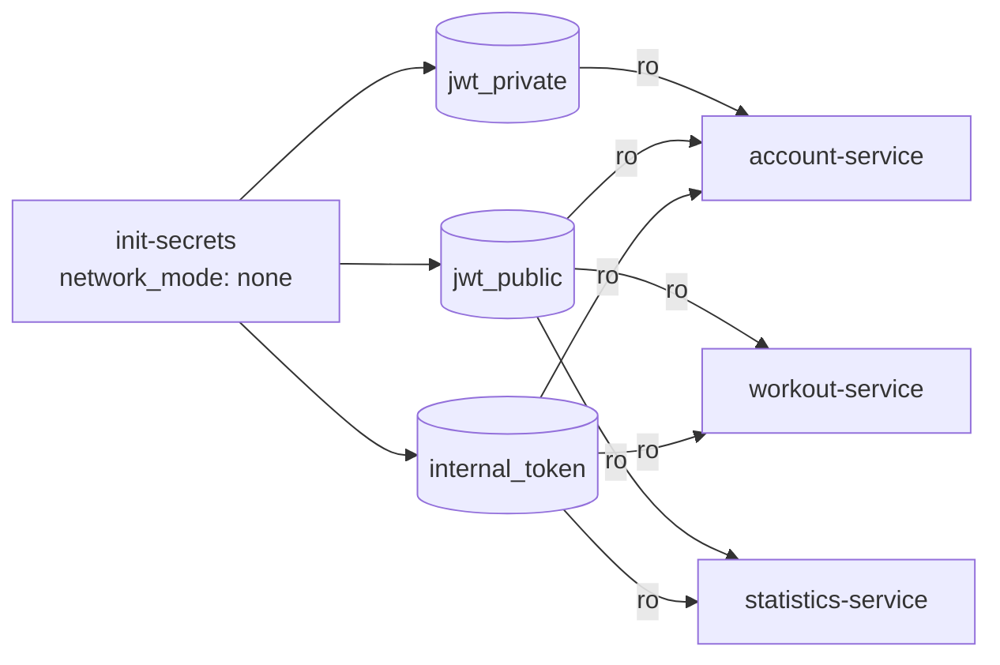
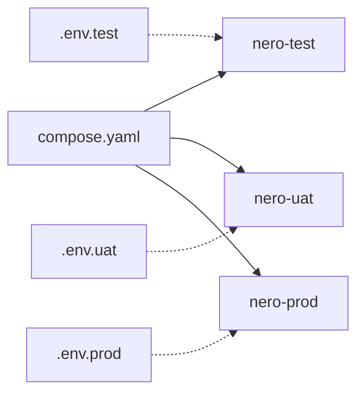

# 5. docker-compose

[← Dockerfiles](04-dockerfiles.md) · [Sommaire](README.md) · [Suivant : CI/CD →](06-ci-cd.md)

L'application complète démarre en une commande :

```bash
cp .env.example .env
```

Renseigner `ACCOUNT_APP_SECRET` et `REDIS_PASSWORD` dans `.env` (par exemple
avec `openssl rand -hex 32` pour chaque valeur), puis lancer :

```bash
docker compose up -d --build --wait
```

- `--build` reconstruit les images à partir des sources : chaque service
  déclare `build.context` et `build.target: runtime`.
- `--wait` ne rend la main que lorsque tous les services sont *healthy*.

## Conteneurs

| Service | Type | Image / build | Rôle |
|---|---|---|---|
| `postgres` | permanent | `infra/postgres` | Base de données |
| `redis` | permanent | `redis:8-alpine` | Cache des statistiques |
| `init-secrets` | ponctuel | `infra/secrets` | Génère les clés JWT et le jeton interne |
| `account-migration` | ponctuel | image account-service | Migrations Doctrine |
| `workout-migration` | ponctuel | image workout-service | Migrations TypeORM |
| `account-service` | permanent | `services/account-service` | API comptes |
| `workout-service` | permanent | `services/workout-service` | API entraînements |
| `statistics-service` | permanent | `services/statistics-service` | API statistiques |
| `front` | permanent | `front` | Interface web |

Les conteneurs ponctuels (`restart: "no"`) s'arrêtent une fois leur tâche
terminée. Les autres sont en `restart: unless-stopped`.

## Ordre de démarrage

L'ordre ne repose pas sur un simple ordre de lancement : chaque dépendance
attend que l'autre soit **prête** (`service_healthy`) ou **terminée avec
succès** (`service_completed_successfully`).



*(en pointillés : conteneurs ponctuels)*

- Un service ne démarre que si ses **migrations ont réussi** : il ne tourne
  jamais sur un schéma pas à jour.
- Les migrations utilisent **la même image** que leur service, avec une autre
  commande : il n'y a pas d'image à maintenir en plus.
- Dans `compose.yaml`, `account-migration` crée aussi l'administrateur. Il attend
  `init-secrets` et reçoit le jeton interne en lecture seule ainsi que l'URL du
  workout-service, nécessaires à l'initialisation du service de comptes.
- Si une étape échoue, `docker compose up --wait` échoue lui aussi au lieu de
  démarrer une application à moitié fonctionnelle.

## Réseaux


| Réseau | `internal` | Membres |
|---|---|---|
| `public` | non | front |
| `backend` | oui | front, account, workout, statistics |
| `database` | oui | postgres, account, workout, migrations |
| `cache` | oui | statistics, redis |

- **Seul le front publie un port.** Les backends, PostgreSQL et Redis ne sont
  joignables par aucun client.
- Les réseaux `internal: true` n'ont aucun accès vers l'extérieur, ni depuis
  l'extérieur.
- **Moindre privilège réseau** : le front n'est pas sur le réseau `database`,
  le statistics-service non plus, et seul le statistics-service voit Redis. Un
  service compromis ne voit que ce dont il a besoin.

## Secrets

Aucun secret n'est commité ni intégré dans une image.



- **Génération automatique** : au premier lancement, `init-secrets` (sans
  réseau) génère la paire de clés RSA 2048 des JWT et le jeton interne dans des
  volumes nommés.
- **Idempotent** : il ne régénère rien si les secrets existent déjà, et vérifie
  que la clé publique correspond bien à la clé privée. Un redémarrage n'invalide
  donc pas les sessions.
- **Moindre privilège** : seul l'account-service monte la clé privée. Les autres
  ne reçoivent que la clé publique et le jeton interne, toujours en lecture
  seule (`:ro`).
- **Variables obligatoires** : les mots de passe sont déclarés en
  `${VAR:?VAR is required}`. `docker compose` refuse de démarrer si l'une
  d'elles manque, plutôt que de lancer une base sans mot de passe.
- Le fichier `.env` est ignoré par Git ; `.env.example` sert de modèle.

## Factorisation

La configuration de connexion à la base est définie une seule fois avec des
ancres YAML, puis réutilisée par chaque service et sa migration :

```yaml
x-account-db: &account-db
  DB_HOST: postgres
  DB_USER: ${ACCOUNT_DB_USER:?ACCOUNT_DB_USER is required}
  # ...

services:
  account-service:
    environment:
      <<: *account-db
```

## Environnements (TEST / UAT / PROD)

Les variables d'environnement permettent d'adapter `compose.yaml` au lancement
local. Le fichier local `test.compose.yaml`, ignoré par Git et absent d'un clone,
est la variante de déploiement : il utilise les
images GHCR sélectionnées par `NERO_TAG`, et expose le front via Traefik sur
`workout.projects.hardev.eu`, sans publier de port sur l'hôte. Le réseau externe
`traefik_public` et Traefik doivent déjà être configurés. Les services, volumes
et limites de ressources suivent la même structure dans les deux fichiers.

| Variable | Rôle | Exemple TEST / UAT / PROD |
|---|---|---|
| `COMPOSE_PROJECT_NAME` | Isole conteneurs, réseaux et volumes sur un même hôte | `nero-test` / `nero-uat` / `nero-prod` |
| `FRONT_PORT` | Évite les conflits de port | `3000` / `3100` / `80` |
| `AUTH_COOKIE_PREFIX` | Cookies distincts par environnement | `test` / `uat` / `nero` |
| `AUTH_COOKIE_SECURE` | `Secure` obligatoire derrière HTTPS | `false` / `true` / `true` |
| Mots de passe, `ACCOUNT_APP_SECRET`, `REDIS_PASSWORD` | Secrets propres à chaque environnement | — |



```bash
docker compose --env-file .env.uat up -d --wait
```

Les noms `.env.test`, `.env.uat` et `.env.prod` illustrent des configurations
possibles ; ces fichiers ne sont pas fournis dans le dépôt. Le modèle livré est
`.env.example`.

## Limites CPU / mémoire

`compose.yaml` et `test.compose.yaml` définissent `deploy.resources.limits`
pour chaque conteneur. `compose.demo.yaml` limite aussi le conteneur de fixtures.

| Service | CPU (équivalent cœur) | RAM maximale |
|---|---|---|
| postgres | 1 | 512 Mio |
| account-service | 1 | 512 Mio |
| workout-service | 1 | 512 Mio |
| statistics-service | 1 | 512 Mio |
| front | 1 | 512 Mio |
| redis | 0,25 | 128 Mio |
| init-secrets | 0,25 | 64 Mio |
| account-migration | 0,5 | 512 Mio |
| workout-migration | 0,5 | 256 Mio |
| demo-fixture (sur demande) | 0,5 | 256 Mio |

Ce sont des plafonds d'exécution par conteneur, sans réservation de CPU ou de
RAM. Ils ne limitent pas la construction des images. Les six services permanents
ont un plafond RAM cumulé de 2 688 Mio ; prévoir aussi le système hôte et les
conteneurs ponctuels. Redis conserve `maxmemory 64mb` pour ses données, sous le
plafond de 128 Mio du conteneur.

Ces valeurs constituent un dimensionnement initial pour la démonstration et
restent à valider en charge. Une modification du fichier Compose prend effet
lors de la recréation des conteneurs concernés.

## Données de démonstration

`compose.demo.yaml` ajoute un service `demo-fixture` qui n'est chargé qu'à la
demande :

```bash
docker compose -f compose.yaml -f compose.demo.yaml run --build --rm demo-fixture
```

Il crée un compte de démonstration et environ 70 séances sur 24 semaines **en
passant par les API** des services, sans écrire directement dans leurs tables.
Le conteneur est en lecture seule (`read_only: true`) et n'est que sur le réseau
`backend`. Il est idempotent : une relance réutilise les ressources existantes.
