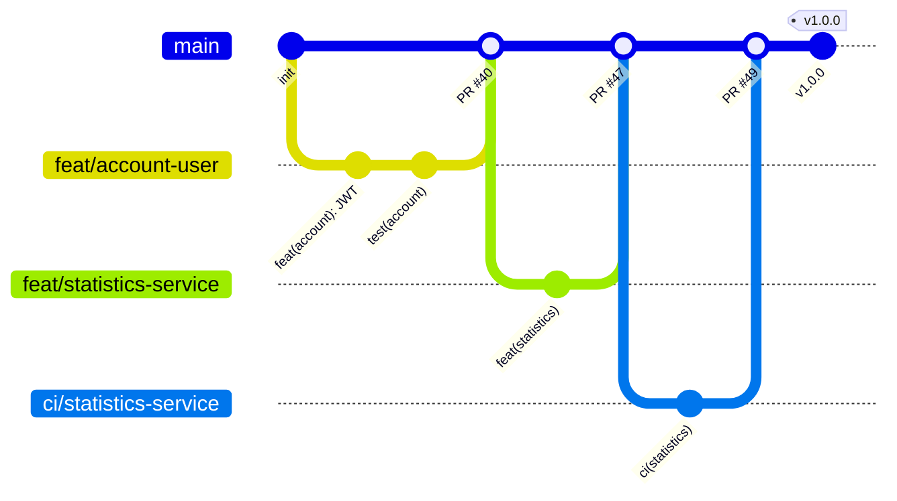
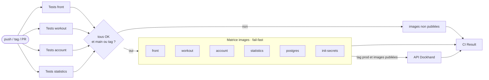
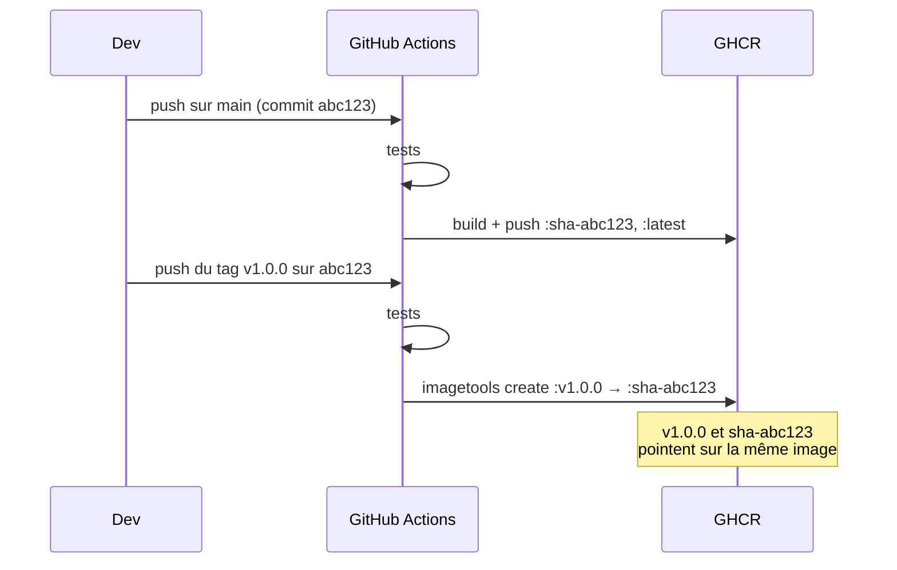

# 6. Dépôt Git et pipeline CI/CD

[← docker-compose](05-docker-compose.md) · [Sommaire](README.md) · [Suivant : Gestion de projet →](07-gestion-projet.md)

## Organisation du dépôt

Un **monorepo** GitHub, avec un dossier par composant :

```
.
├── front/
├── services/
│   ├── account-service/
│   ├── workout-service/
│   └── statistics-service/
├── infra/
│   ├── postgres/
│   └── secrets/
├── scripts/demo/
├── compose.yaml
├── compose.prod.yaml
├── compose.demo.yaml
└── .github/workflows/
```

**Pourquoi un monorepo ?**

- un seul `git clone`, la copie de `.env.example` en `.env` et
  `docker compose up -d --build --wait` suffisent pour le démarrage local ;
- quand un contrat d'API change, ses deux côtés évoluent dans la même pull
  request ;
- la CI est factorisée par langage (workflows réutilisables) ;
- chaque service reste autonome : son Dockerfile, ses dépendances, ses tests et
  son image.

### Branches et pull requests



- Une branche par fonctionnalité (`feat/…`, `ci/…`, `chore/…`, `docs/…`),
  fusionnée dans `main` par pull request.
- Messages au format **Conventional Commits** (`feat(account): …`, `ci: …`,
  `build(account): …`), ce qui rend l'historique lisible par service.
- `.gitattributes` force les fins de ligne LF sur les scripts shell (voir la
  [rétrospective](08-retrospective.md)).

## Pipeline GitHub Actions

Le workflow principal [`ci.yml`](../.github/workflows/ci.yml) se déclenche
**à chaque push (toutes les branches et tous les tags) et à chaque pull
request**. Il appelle des workflows réutilisables (`workflow_call`), un par
langage :

| Workflow | Utilisé par | Étapes |
|---|---|---|
| `node-tests.yml` | front, workout-service | Node 24, `npm ci`, `npm test` |
| `php-tests.yml` | account-service | PHP 8.4 + extensions, `composer install`, PHPUnit |
| `python-tests.yml` | statistics-service | uv, `uv sync --locked`, pytest |
| `docker-image.yml` | les 6 images | Build Buildx et publication sur GHCR |



### Échec immédiat

- Les quatre suites de tests tournent **en parallèle**.
- Le job `images` dépend (`needs`) des quatre : **un seul test en échec bloque
  toute publication**.
- La matrice d'images est en `fail-fast` : si une image ne se construit pas, les
  autres sont annulées.
- Le job final `CI Result` attend aussi le job de déploiement, lorsqu'il est
  exécuté, et échoue si un job échoue. Il sert de
  **statut unique** pour la protection de la branche `main`.

## Images et identifiants uniques

Les images sont publiées sur **GitHub Container Registry** :
`ghcr.io/antonharzhanau/nero-workout-<service>`.

| Événement | Étiquettes produites |
|---|---|
| Push sur `main` | `sha-<hash complet du commit>` et `latest` |
| Push d'un tag `vX.Y.Z` | `vX.Y.Z` |

Les étiquettes sont calculées par `docker/metadata-action`.

Le fichier `compose.prod.yaml` utilise ces six images (`front`, `account`,
`workout`, `statistics`, `postgres`, `init-secrets`) avec un même `NERO_TAG`.
Les services de migration réutilisent les images Account et Workout ; Redis
provient directement de son image externe épinglée.

Après configuration du `.env`, les images publiées se lancent avec
`docker compose -f compose.yaml -f compose.prod.yaml up -d --wait`. La surcharge
supprime les builds et impose le téléchargement des images. `latest` suit les
publications sur `main` ; un tag de release ou `sha-<SHA complet>` sélectionne
une version précise déjà présente dans GHCR.

Le push du tag Git `prod` déclenche aussi le job `Deploy production`, uniquement
après le succès de toute la matrice d'images. Il appelle l'API de Dockhand pour
redéployer le stack existant avec téléchargement des images, sans build et avec
recréation des conteneurs. Le Compose utilisé reste celui enregistré dans
Dockhand ; ses images doivent utiliser `NERO_TAG=prod` ou le tag `:prod`.

Deux secrets GitHub Actions sont nécessaires : `DOCKHAND_API_TOKEN` (jeton API
Dockhand) et `DOCKHAND_DEPLOY_URL` (URL complète
`https://<dockhand>/api/stacks/<nom>/deploy?env=<id>`). L'URL doit être accessible
depuis le runner GitHub. Une variable manquante ou une erreur HTTP fait échouer
le job ; la santé de l'application reste à vérifier dans Dockhand. Les autres
branches et tags ne déclenchent pas de déploiement.

### Une release ne reconstruit pas l'image



Pour un tag, l'étape `imagetools create` ajoute l'étiquette du tag à l'image
`sha-<commit>` déjà construite et testée sur `main`. L'image de release est donc
exactement celle qui a passé la CI, octet pour octet.

### Cache de build

Le cache Buildx est stocké dans le registre (`:buildcache`, `mode=max`) : les
runners, qui repartent de zéro à chaque exécution, réutilisent quand même les
couches des builds précédents.

## Sécurité et robustesse de la pipeline

| Pratique | Détail |
|---|---|
| Permissions minimales | `contents: read` par défaut ; `packages: write` accordé uniquement au job de publication |
| Pas de secret à gérer | Authentification à GHCR par le `GITHUB_TOKEN` éphémère du run |
| Timeouts | `timeout-minutes` sur chaque job |
| Annulation des runs obsolètes | `concurrency` : une nouvelle poussée sur une PR annule le run précédent |
| Reproductibilité | `npm ci`, `composer install` sur le lock, `uv sync --locked`, versions d'outils épinglées |

## Pistes d'amélioration

- Analyse de vulnérabilités des images (Trivy, Docker Scout).
- Lint et analyse statique dans la pipeline (oxlint, ESLint, PHPStan, Ruff).
- Test de démarrage du `compose.yaml` complet dans la CI.
- Publication d'une image pour chaque commit de branche, pas seulement sur
  `main` et les tags.
