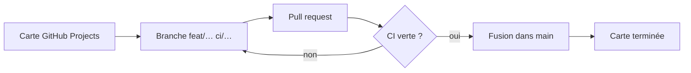
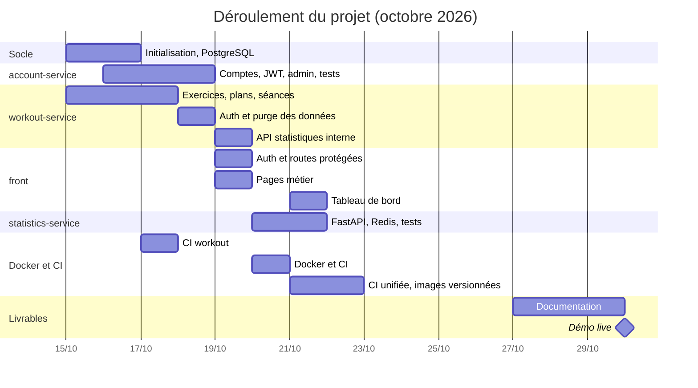

# 7. Gestion de projet

[← CI/CD](06-ci-cd.md) · [Sommaire](README.md) · [Suivant : Rétrospective →](08-retrospective.md)

## Outils

Le suivi des tâches a été fait avec **GitHub Projects** : chaque fonctionnalité
ou tâche technique y était une carte. Chaque carte était réalisée dans une
branche dédiée, puis fusionnée dans `main` par pull request
([voir le workflow Git](06-ci-cd.md#branches-et-pull-requests)).

## Répartition

Répartition principale, telle qu'elle apparaît dans l'historique Git :

| Anton Harzhanau | Dzidoula Godwin KPOGLO |
|---|---|
| Initialisation du dépôt, PostgreSQL (rôles et schémas) | account-service : comptes, JWT RS256, refresh tokens, admin |
| workout-service (exercices, plans, séances, API interne) | Tests unitaires de l'account-service |
| Frontend Next.js | statistics-service (FastAPI, cache Redis, tests) |
| Mise en place Docker et CI, publication des images | Conteneurisation de l'account-service et du statistics-service, CI du statistics-service |

## Chronologie

