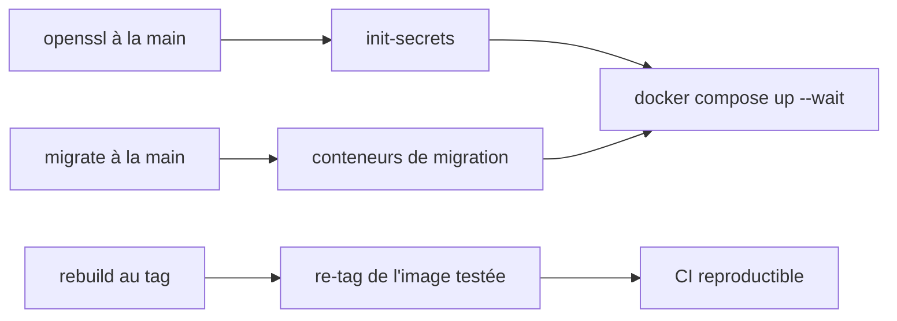

# 8. Rétrospective

[← Gestion de projet](07-gestion-projet.md) · [Sommaire](README.md)

## Difficultés rencontrées et solutions

| Difficulté | Solution |
|---|---|
| **Génération manuelle des secrets** : au départ, chaque développeur devait créer les clés JWT et le jeton interne avec `openssl` avant le premier lancement, d'où des oublis et des erreurs. | Conteneur `init-secrets` idempotent lancé par le compose, qui écrit dans des volumes montés en lecture seule ([voir Secrets](05-docker-compose.md#secrets)). |
| **Migrations lancées à la main** après le démarrage (`docker compose exec … migrate`). | Conteneurs de migration ponctuels et `depends_on: service_completed_successfully`. |
| **Fins de ligne CRLF** sous Windows : les scripts shell copiés dans les images échouaient sous Linux. | `.gitattributes` imposant LF sur les `*.sh`. |
| **Cache Symfony au build** : `cache:warmup` exige des variables de connexion à la base qui n'existent pas au moment du build. | Valeurs factices passées uniquement à la commande de warmup ; les vraies valeurs sont injectées à l'exécution. |
| **FrankenPHP en non root** : le binaire porte une capability réseau qui pose problème sous un utilisateur sans privilège. | `setcap -r` sur le binaire et écoute sur le port 8080. |
| **Partage de données entre services** sans base commune (suppression de compte, statistiques). | Routes `/internal` authentifiées par un jeton partagé ; snapshots des exercices dans les séances ([voir Données](03-donnees.md)). |
| **Variables partagées du compose** modifiées en parallèle dans deux branches, d'où des conflits de fusion. | Ancres YAML et variables obligatoires centralisées dans `.env.example`. |
| **Images de release** reconstruites à partir du tag, donc potentiellement différentes de celles testées. | Re-étiquetage de l'image `sha-<commit>` existante au lieu d'un nouveau build ([voir CI/CD](06-ci-cd.md#une-release-ne-reconstruit-pas-limage)). |

Toutes ces difficultés vont dans le même sens : chaque étape manuelle a fini
par être automatisée dans le compose ou la CI.

## Si c'était à refaire

- **Poser le socle Docker dès le premier jour** (compose, secrets, migrations,
  CI) avant d'écrire le code métier : plusieurs étapes manuelles ont dû être
  automatisées après coup.
- **Écrire les contrats d'API entre services** (OpenAPI) avant de les
  implémenter, pour développer le front et les backends en parallèle avec moins
  d'allers-retours.
- **Enrichir la pipeline** : analyse de vulnérabilités des images (Trivy,
  Docker Scout), lint systématique, test de démarrage du compose complet.
- **Définir dès le départ les fichiers d'environnement et les limites de
  ressources** dans le compose : les plafonds CPU / RAM ont été ajoutés en fin
  de projet, avec les mêmes valeurs pour le lancement local et le déploiement
  GHCR.
