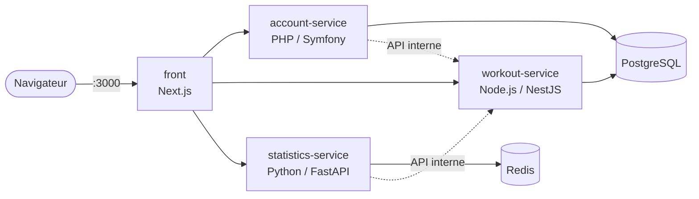

# Documentation du projet Nero 

Ynov Master 2 - binôme : Anton Harzhanau, Dzidoula Godwin KPOGLO
Dépôt : <https://github.com/AntonHarzhanau/Nero-Workout>

Nero est une application web de suivi de musculation : catalogue d'exercices,
plans d'entraînement, saisie des séances (séries, charges, répétitions) et
tableau de bord de progression.

Le rapport de projet, disponible en [français](Rapport.md), regroupe l'architecture, les choix
Docker et CI/CD, l'organisation du travail et la rétrospective dans un seul document.



## Sommaire

| # | Document | Contenu |
|---|---|---|
| 1 | [Architecture logicielle](01-architecture.md) | Services, responsabilités, API REST, communication entre services |
| 2 | [Authentification et sessions](02-authentification.md) | JWT RS256, refresh tokens, front sans état, contrôle d'accès, rôles |
| 3 | [Données](03-donnees.md) | PostgreSQL, schémas et rôles par service, modèle de données, cache Redis |
| 4 | [Dockerfiles](04-dockerfiles.md) | Builds multi-étapes, images, bonnes pratiques |
| 5 | [docker-compose](05-docker-compose.md) | Orchestration, réseaux, secrets, environnements, limites |
| 6 | [Dépôt Git et CI/CD](06-ci-cd.md) | Organisation du dépôt, pipeline GitHub Actions, registre d'images |
| 7 | [Gestion de projet](07-gestion-projet.md) | Organisation, répartition, chronologie |
| 8 | [Rétrospective](08-retrospective.md) | Difficultés, solutions, ce qu'on referait autrement |

## Démarrage rapide

```bash
cp .env.example .env
```

Renseigner `ACCOUNT_APP_SECRET` et `REDIS_PASSWORD` dans `.env` avant de
démarrer (par exemple avec `openssl rand -hex 32` pour chaque valeur).

```bash
docker compose up -d --build --wait
```

Application disponible sur <http://localhost:3000> : `/` redirige vers `/login`,
la page d'accueil publique. Les détails (compte admin,
données de démonstration) sont dans le [README principal](../README.md).

## Respect des contraintes du sujet

| Contrainte | Mise en œuvre | Détails |
|---|---|---|
| Frontend web conteneurisé | `front` (Next.js) | [1](01-architecture.md) |
| ≥ 3 backends conteneurisés | account, workout, statistics | [1](01-architecture.md) |
| ≥ 2 langages | PHP, TypeScript/Node.js, Python | [1](01-architecture.md) |
| Frontend sans état | Jetons en cookies HttpOnly, sessions dans l'account-service | [2](02-authentification.md) |
| API HTTP REST | Les trois backends exposent des API JSON | [1](01-architecture.md) |
| Base SQL | PostgreSQL 17, un schéma et un rôle par service | [3](03-donnees.md) |
| Front joignable par les clients | Seul port publié : `FRONT_PORT` → 3000 | [5](05-docker-compose.md) |
| Backends et base non joignables | Réseaux `internal`, aucun port publié | [5](05-docker-compose.md) |
| Tests unitaires par backend | PHPUnit, Vitest, pytest | [1](01-architecture.md#tests) |
| Création de compte, login, logout | `/auth/register`, `/auth/login`, `/auth/logout` | [2](02-authentification.md) |
| Comptes standard / admin | `standard` à l'inscription, `admin` créé au premier démarrage (`ADMIN_*`) ou par commande console | [2](02-authentification.md#rôles-et-suppression-de-comptes) |
| Suppression de son compte | `DELETE /users/me` (données d'entraînement purgées) | [2](02-authentification.md#rôles-et-suppression-de-comptes) |
| Admin supprime des comptes standard | `DELETE /admin/users/{id}`, règle dans `UserVoter` | [2](02-authentification.md#rôles-et-suppression-de-comptes) |
| Accès restreint avant connexion | Accueil public `/login`, inscription `/register`, layout `(private)` protégé | [2](02-authentification.md#contrôle-daccès-côté-front) |
| Dockerfiles | Un par service, multi-étapes, non root | [4](04-dockerfiles.md) |
| docker-compose en une commande | `docker compose up -d --build --wait` | [5](05-docker-compose.md) |
| Tests à chaque push de commit / tag | `on: push` + `pull_request` ; builds sur `main`, ré-étiquetage aux tags | [6](06-ci-cd.md) |
| Image avec identifiant unique | `sha-<commit>` ou nom du tag | [6](06-ci-cd.md#images-et-identifiants-uniques) |
| Publication dans un registre | GitHub Container Registry | [6](06-ci-cd.md#images-et-identifiants-uniques) |
| Échec immédiat en cas d'erreur | `needs` + matrice `fail-fast` + job `CI Result` | [6](06-ci-cd.md) |
