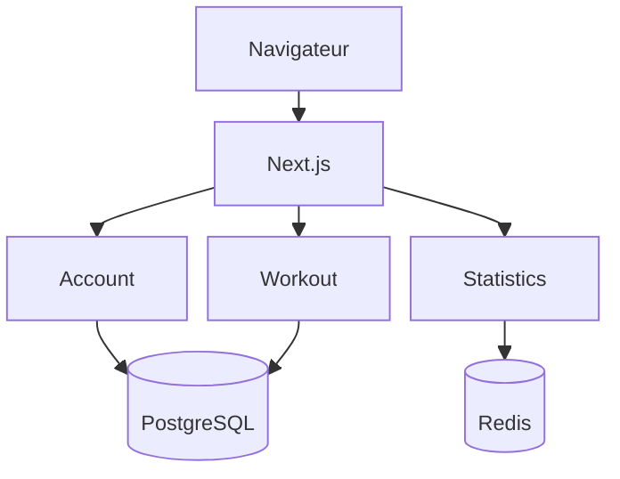

<style>
@media print {
  h1, h2, h3 { break-after: avoid; }
  table, pre, .mermaid { break-inside: avoid; }
}
.mermaid svg, svg[id^="mermaid"] {
  display: block;
  width: auto !important;
  height: auto !important;
  max-width: min(100%, 150mm) !important;
  max-height: 75mm !important;
  margin: 0 auto;
}
</style>

# Rapport de projet Nero-Workout

**Module :** « Dév avec Docker », Ynov Master 2  
**Auteurs :** Anton Harzhanau, Dzidoula Godwin KPOGLO  
**Date :** 29 octobre 2026  
**Dépôt :** [github.com/AntonHarzhanau/Nero-Workout](https://github.com/AntonHarzhanau/Nero-Workout)

Nero-Workout est une application de suivi de musculation. L’utilisateur crée
des exercices et des plans, enregistre ses séries, charges et répétitions,
puis consulte sa progression. Nous avons réparti l’application entre trois
services : comptes, entraînements et statistiques.

## 1. Architecture

| Composant | Technologies | Rôle |
|---|---|---|
| Frontend | TypeScript, Next.js | Pages, formulaires, appels aux API |
| Account | PHP, Symfony | Comptes, rôles, authentification |
| Workout | TypeScript, NestJS | Exercices, plans, séances |
| Statistics | Python, FastAPI | Calcul de la progression et des indicateurs de force |
| PostgreSQL | SQL | Données persistantes |
| Redis | Cache | Résultats des calculs statistiques |



Le navigateur communique uniquement avec le frontend. Next.js appelle les API
REST côté serveur ; les backends et la base ne publient aucun port sur l’hôte.
En complément des liens du schéma, Statistics lit l’historique via l’API interne
de Workout, qu’Account appelle aussi pour supprimer les données d’un utilisateur.
Ces requêtes sont protégées par un jeton interne.

Dans PostgreSQL, Account et Workout disposent de schémas et de rôles distincts.
Une seule instance réduit la consommation mémoire, tandis que les rôles
séparent les accès aux tables. Statistics récupère les données par API et met
les calculs en cache dans Redis. La perte du cache ne supprime pas l’historique.

Account émet des JWT signés en RS256. Workout et Statistics reçoivent la clé
publique ; seul Account possède la clé privée. Les jetons sont dans des cookies
HttpOnly du navigateur et les sessions dans PostgreSQL. Le frontend ne conserve
pas les sessions en mémoire et reste sans état.

La page d’accueil publique est `/login`, vers laquelle `/` redirige.
L’inscription est également accessible sans connexion. Les autres sections
nécessitent une authentification. Les utilisateurs standard et les administrateurs
peuvent supprimer leur propre compte. Un administrateur peut aussi supprimer
un autre compte standard. Ces règles sont vérifiées côté backend. Le premier
administrateur est créé au démarrage à partir des variables d’environnement.

## 2. Docker et Compose

Le frontend et chaque backend ont leur propre Dockerfile. La construction
se fait en plusieurs étapes : installation des dépendances, préparation
de l’application et image finale. Next.js utilise `standalone`, Workout est
compilé en JavaScript, Account fonctionne avec FrankenPHP et Statistics
avec Uvicorn.

Les dépendances sont installées à partir des fichiers de verrouillage.
Les manifestes sont copiés avant les sources pour conserver le cache
d’installation lorsque seul le code change. Les images de base sont fixées
par version et SHA256. Les applications tournent sans root ; `.dockerignore`
exclut les dépendances locales, les caches et les fichiers d’environnement.

Avant le lancement, il faut copier `.env.example` vers `.env` et renseigner
les secrets, dont `ACCOUNT_APP_SECRET` et `REDIS_PASSWORD`, puis exécuter :

```bash
docker compose up -d --build --wait
```

Compose lance six conteneurs permanents et trois tâches ponctuelles.
`init-secrets` génère les clés JWT et le jeton interne dans des volumes nommés,
conservés lors des redémarrages. Les conteneurs `account-migration`
et `workout-migration` appliquent les migrations une fois PostgreSQL prêt.
Les backends démarrent après les migrations ; le frontend attend les API.
L’ordre est défini par les healthchecks et `depends_on`.

Compose définit quatre réseaux : `public`, `backend`, `database` et `cache`.
Les trois derniers sont internes. Seul le frontend publie le port `3000:3000` ;
il n’est pas connecté au réseau de la base. PostgreSQL stocke ses données
dans `postgres_data`. Les fichiers de clés sont montés en lecture seule.

Les connexions, le port et les cookies sont configurés par l’environnement.
Le fichier local `test.compose.yaml` utilise les images GHCR choisies par
`NERO_TAG` et le routage Traefik. Ce fichier est ignoré par Git ; le lancement
à partir d’un clone utilise le fichier principal `compose.yaml`.

Les ressources sont limitées par `deploy.resources.limits` :

| Conteneurs | CPU | RAM |
|---|---|---|
| Frontend, Account, Workout, Statistics, PostgreSQL — chacun | 1 | 512 Mio |
| Redis | 0,25 | 128 Mio |
| Générateur de secrets | 0,25 | 64 Mio |
| Migration Account | 0,5 | 512 Mio |
| Migration Workout, chargement des données de démo — chacun | 0,5 | 256 Mio |

Ces plafonds concernent l’exécution des conteneurs, pas la construction
des images. Les valeurs n’ont pas encore été vérifiées par un test de charge.

## 3. Git et CI/CD

Les sources sont regroupées dans un dépôt : `front/`, `services/`, `infra/`
et `docs/`. Une modification d’API et son utilisation côté frontend peuvent
ainsi faire partie de la même pull request. Chaque tâche a sa branche ;
après vérification, les changements sont fusionnés dans `main`.

GitHub Actions lance les tests à chaque push de branche ou de tag et à chaque
mise à jour d’une pull request. Les jobs tournent en parallèle : PHPUnit pour
Account, Vitest pour Workout et le frontend, pytest pour Statistics. Les étapes
communes sont regroupées dans des workflows réutilisables par langage.

Après la réussite des tests sur `main`, six images sont construites et publiées :
le frontend, les trois backends, PostgreSQL et le générateur de secrets.
Le registre utilisé est GitHub Container Registry. Les images reçoivent
les étiquettes `sha-<hash complet du commit>` et `latest`.

Lors du push d’un tag de release, les tests sont relancés et les images SHA
existantes reçoivent le nom de la release. Nous avons choisi ce fonctionnement
pour éviter de construire six images à chaque changement de branche, puis
à nouveau lors d’une release. Avant de pousser le tag, il faut attendre
la publication des images du commit correspondant sur `main`.

Un test en échec bloque la publication. La matrice de construction utilise
`fail-fast` ; le job `CI Result` vérifie le résultat global. Le cache Buildx
dans le registre accélère les builds. La publication utilise le jeton
temporaire `GITHUB_TOKEN`.

Les tests couvrent l’authentification et les rôles, les entraînements et
les calculs statistiques. Des scénarios Playwright existent pour le frontend,
mais ne sont pas encore inclus dans le pipeline commun. Lors de la préparation
du rapport, la validation des configurations Compose a été effectuée.
Le lancement complet de l’application et les tests de charge n’ont pas été
réexécutés à cette occasion.

## 4. Organisation du travail

Le projet a été réalisé à deux. Les tâches étaient suivies dans GitHub Projects
et le code fusionné par pull requests.

**Anton Harzhanau :** dépôt, PostgreSQL et droits d’accès, Workout,
frontend, configuration générale de Docker et de la CI/CD, publication des images.

**Dzidoula Godwin KPOGLO :** Account et ses tests, Statistics et ses tests,
conteneurisation de ces services et CI de Statistics.

Le travail s’est déroulé par étapes : base et backends, authentification
et frontend, statistiques, puis automatisation du lancement et de la publication.
Les modifications des fichiers Compose communs et des contrats d’API étaient
coordonnées entre nous. La documentation et les données de démonstration
ont été préparées en fin de projet.

Un script crée par API un compte, des exercices, des plans et environ
70 séances sur 24 semaines. Il se lance séparément avec `compose.demo.yaml`.
Cela permet de présenter les graphiques sans saisir tout l’historique à la main.

## 5. Rétrospective

**Préparation manuelle de l’environnement.** Au départ, les clés et les migrations
étaient préparées à la main. Nous avons déplacé ces opérations dans des conteneurs
ponctuels. Une fois `.env` renseigné, une commande suffit au lancement.

**Différences entre Windows et Linux.** Les scripts shell avec des fins de ligne
CRLF ne s’exécutaient pas dans les conteneurs. Nous avons imposé LF pour `*.sh`
avec `.gitattributes`.

**Construction de Symfony.** Le préchauffage du cache exigeait les variables
de la base avant même le démarrage du conteneur. Nous avons fourni des valeurs
temporaires pour cette commande ; les vraies sont injectées au lancement.
Pour exécuter FrankenPHP sans root, nous avons retiré la capability du binaire
et choisi le port 8080.

**Données entre services.** Supprimer un compte nécessite de supprimer ses
entraînements. Account appelle d’abord l’API interne de Workout, puis supprime
l’utilisateur si le nettoyage a réussi. Pour les statistiques, nous conservons
le nom de l’exercice et ses groupes musculaires au moment de la séance :
un renommage dans le catalogue ne modifie pas l’historique.

**Fichiers communs et charge CI.** Les modifications parallèles de Compose
provoquaient des conflits ; les paramètres répétés ont été regroupés avec
des ancres YAML. Nous avons réduit les builds : les branches exécutent les tests,
`main` construit les images et les releases réutilisent le résultat.

Si nous recommencions, nous définirions plus tôt l’environnement Docker
et les contrats d’API. Les prochaines étapes sont d’ajouter à la CI le lancement
de l’application complète, les scénarios navigateur et l’analyse des images,
puis d’ajuster les limites de ressources à partir de mesures.

Les instructions et la description des composants sont disponibles
dans la [documentation](README.md).
